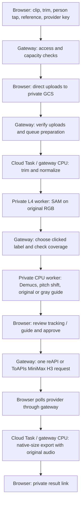

# swapMEin pipeline, dependencies and deployment

**Current reference, revised 14 October 2026.** This document describes the deployed
single-person beta. It replaces the earlier CharSwap writeup and its accumulated
corrections. Runtime settings, deployed worker identities and bucket policies were
checked read-only during this revision; no inference or generation was started.

- Live application: [swapMEin](https://charswap-franky-20261013.web.app).
- Application source: [frankywashere/vlo, branch `tasty`](https://github.com/frankywashere/vlo/tree/tasty).
- Detailed API, IAM and recovery procedures: [gateway runbook](../deployment/swapmein/README.md).
- Frontend: [`frontend/src/features/charSwap`](../frontend/src/features/charSwap).
- Gateway: [`deployment/swapmein`](../deployment/swapmein).
- Separate experiment/worker workspace on the operator's Mac: `/Users/frank/Desktop/Coding/CharSwap`.

## Current pipeline decisions

| Item | Deployed behavior |
| --- | --- |
| Target selection | User taps one person in a paused preview; SAM tracks people in the original RGB video |
| Depth Anything | Omitted from the default pipeline |
| Face mesh | Omitted from the default pipeline |
| Enhanced character masking | **Off by default**; optional solid-gray coverage of the selected SAM label |
| Vocal guidance | Demucs separates vocals; FFmpeg shifts them up three semitones without changing tempo |
| Generation | Standard MiniMax H3 through the user's reAPI or ToAPIs key |
| Guide resolution | Normalized to 24 fps within an 854×480 canvas, with padding when required |
| Generation resolution | Current standard-H3 route requests 768p; no Max/Lite/Turbo model integration |
| Final resolution | Preserve the provider's generated dimensions; no automatic downscale to 480p or upscale to the uploaded source |
| Final soundtrack | Restore the selected section of the original uploaded soundtrack; discard provider audio |
| Current scope | One selected person in one continuous 4–15-second shot |
| Preparation allowance | 100 attempts/day and 3,100/month, UTC; uploads have a separate allowance of the same size |
| Financial protection | Project-specific CAD$7/month Cloud Run spending cap remains; CAD$10 budget is an alert |

The final result is a generated replacement video, not a pixel-perfect edit of the
source. Motion, mouth movement, anatomy and background fidelity require visual and
audio review. A successful task or mask in every frame does not establish creative
quality or identity correctness.

## User flow

1. **Clip:** choose a local video. It stays on the device until cloud preparation.
2. **Trim:** select the section before choosing people. The starting time may be
   fractional; the selected duration currently must be a whole number from 4–15
   seconds. Both integrated H3 APIs document integer output durations. Automatic
   round-up generation followed by an exact fractional trim is a proposed change,
   not deployed behavior.
3. **People:** pause on a clear frame and tap inside the intended person's body.
   Keyboard selection is also available. The live beta allows one target; the
   local demo can show multiple targets.
4. **References:** tap the image tile or Upload button to assign a replacement
   image to that person. Each card holds its own person-to-reference mapping.
5. **Check all scenes / Matches:** the button starts preparation. The site shows
   the real access, capacity, upload, confirmation, queued and preparation stages,
   with elapsed time and an indeterminate progress bar. It checks capacity before
   reading/uploading media and checks again before issuing upload links. Daily,
   monthly, busy and recovery errors are distinguished; known reset times display
   in the browser's local timezone. A refused check stays on References.
6. **Access:** choose a personal provider key or the app-credit preview. A real key
   must already be supplied in Settings before preparation validates access. Both
   reAPI and ToAPIs are available. Real app-credit purchases and generation using
   app credits are not implemented.
7. **Review:** confirm tracking/guide playback, the assigned reference and the
   estimate, then explicitly approve one generation. A completed result provides
   a private download link.

Despite the button wording, **“Check all scenes” currently checks the selected
continuous shot**. Camera cuts are rejected before GPU processing; automatic
cross-shot matching is not implemented. The local demo's uncertainty cases are
simulated. The production system does not calculate or expose identity-confidence
scores.

## End-to-end processing and where it runs



| Stage | Processing location | Actual work |
| --- | --- | --- |
| Playback, trim selection, tap, mapping | User's browser | Local media preview and setup only |
| Access and ownership | `swapmein-api` CPU | Validate the entered provider key, create a six-hour session, bind jobs to that session/provider |
| File transfer | Browser → private application bucket | Signed direct PUTs; large media does not pass through Firebase's API rewrite |
| Source preparation | Gateway CPU, authenticated Cloud Task | FFmpeg validates, trims, rotates, normalizes to 24 fps, and checks for cuts |
| Segmentation | `proof-gpu`, NVIDIA L4 | SAM 3 detects/tracks people using text prompt `person`; returns labeled masks for each frame |
| Target resolution | Gateway CPU | Find the label at the selected position/time and require nonzero coverage in every frame |
| Audio and guide | `proof-audio` CPU | Demucs vocal separation, +3 semitone guidance, mask validation/cleanup and guide assembly |
| Video generation | reAPI or ToAPIs infrastructure | MiniMax H3 receives one guide video, one reference image and the replacement prompt |
| Final export | Gateway CPU, authenticated Cloud Task | Validate output timing/framing, trim small extra tail frames, restore source audio and retain generated dimensions |

**The normal hosted workflow performs no processing on the operator's Mac.** The
Mac is used for development, deployment and optional historical experiment/iCloud
helpers. A visitor's device previews files and uploads them; it does not run SAM,
Demucs or FFmpeg.

### Masks and the optional gray guide

SAM processes the original RGB clip in both settings. It does not select a named
identity automatically. The gateway chooses the numerical label beneath the
user's tap and checks coverage. A label can still track the wrong person, merge,
or drift, so review is required.

With **Use enhanced character masking off**, the guide retains the original
person. The prompt identifies the intended target using the clicked position and
time. The main review player shows the labeled tracking preview, with a separate
link to the actual generation guide.

With the setting **on**, the CPU compositor paints the selected label flat RGB
`128,128,128`, preserving source pixels outside it. The prompt refers to that gray
silhouette, and the main review player shows the guide. This is a flat 2D guide;
there is no depth or mesh stage.

The raw mask archive is used by our preparation workers; H3 receives the assembled
video, not a separate SAM mask parameter. Changing masking or selection invalidates
prepared guidance and approval. Old saved jobs missing the masking option retain
their historical gray interpretation; new jobs default to off.

### Audio and export timing

The audio worker always runs Demucs `htdemucs` with two-stem vocal separation on
CPU, then uses FFmpeg's Rubber Band filter with `tempo=1` and pitch ratio
`1.189207115` (+3 semitones). The shifted vocals are embedded in the guide as mouth
movement guidance. They are not the delivered soundtrack.

Finishing reads audio from the **original uploaded source at the selected trim
start**, not the normalized guide. The export is 24 fps, H.264/AAC MP4 at the
provider's generated width/height. AAC is encoded again, so “original audio
restored” means the original content and timing, not bit-identical encoded bytes.
Small provider overruns within the existing tolerance are trimmed without speeding
up or slowing down the result. Unexpected timing, missing frames/audio or framing
mismatches fail validation rather than silently stretching the video.

A typical five-second proof returned 1344×768 with 124 frames; finishing retained
120 frames at 24 fps. This does not promise that every result will have the same
extra tail or dimensions.

## Media, sessions and storage

- Source upload: at most **100 MiB** (104,857,600 bytes), regular supported video
  container with audio; maximum 4096 pixels per side, 16 megapixels and aspect ratio
  0.4–2.5. Only the selected 4–15-second section is processed.
- Reference: one still JPG, PNG or WebP, at most **5 MiB**, sides 256–5760 pixels,
  aspect ratio 0.4–2.5. It is EXIF-corrected, resized within 2048 pixels and saved as
  a JPEG with metadata stripped.
- Direct upload URLs expire after **15 minutes**. Signatures bind exact file size,
  content type and create-only generation preconditions. The gateway verifies
  both stored sizes and the reference before reserving preparation and queueing.
- The legacy multipart API is retained for older clients, limited to a 25 MiB
  source / 31 MiB total request. New site uploads use the direct path.
- Provider key and bearer session remain only in browser memory. Only hashes,
  provider selection and expiry are saved server-side. There is no owner-key
  fallback, saved-key database or provider key in Cloud Tasks/environment/static
  assets. The compatibility header is named `X-Reapi-Key` for both providers.
- Refreshing/closing the tab clears local keys/session. There is no account-based
  resume feature. Provider status polling requires that user's key and is driven
  by the open browser tab, with a 20-minute automatic polling window and an
  explicit Check status recovery action.

**Keep the tab open through generation/export.** A provider task can continue and
charge while the tab is closed. A completed provider result will not automatically
queue our export until an authenticated status poll observes completion. Clearing
the session does not cancel the provider job.

| Bucket | Current retention policy, checked 14 Oct 2026 |
| --- | --- |
| `charswap-franky-20261013-app` | Lifecycle deletes objects aged two days under `uploads/`, `outputs/`, `sessions/`, `jobs/`; soft delete disabled |
| Same application bucket, `control/` | Excluded from lifecycle; retains quota and lease records |
| `charswap-franky-20261013-proof` | **No lifecycle deletion configured**; worker inputs, outputs and build records persist; deleted objects retained seven days |

Application cleanup does not delete the worker copies. Registry images and
worker-bucket artifacts can therefore remain billable while workers are off.
Historical desktop/iCloud delivery is separate from this web application; there is
no automatic iCloud upload from the site.

## Provider integration

| Setting | reAPI | ToAPIs |
| --- | --- | --- |
| API base | `https://reapi.ai` | `https://toapis.com` |
| Balance | `GET /api/v1/balance` | `GET /v1/balance` |
| Submit | `POST /api/v1/videos/generations` | `POST /v1/videos/generations` |
| Status | `GET /api/v1/tasks/{id}` | `GET /v1/videos/generations/{id}` |
| Model / resolution | `minimax-h3` / `768P` | `MiniMax-H3` / `768p` |
| References | One `reference_image_urls` entry and one `reference_video_urls` entry | One `image_with_roles` / `reference_image` and one `video_with_roles` / `reference_video` |
| Duration / ratio | Integer 4–15 seconds / `adaptive` | Integer 4–15 seconds / `adaptive` |
| Filter parameter sent | `content_filter:false` | No equivalent documented field is forwarded |
| Other protocol field | No controlled seed | Unique `client_business_id`; no controlled seed |

Switching providers clears the key, session, guide and approval. A durable
submission claim prevents automatic duplicate paid POSTs. Uncertain submissions
remain `submission_unknown`; there is no automatic provider fallback or retry.
Downloaded output must pass exact HTTPS host, DNS and redirect checks. Raw provider
credentials are never forwarded to result CDNs.

The common balance interface uses millidollars internally. reAPI credits and
ToAPIs vendor credits must not be compared as if one credit had the same value.
The exact adapters and prompt are in
[`provider.py`](../deployment/swapmein/swapmein/provider.py).

The current routes are verified against [reAPI's H3 reference](https://reapi.ai/models/minimax-h3)
and [ToAPIs' H3 reference](https://docs.toapis.com/docs/en/api-reference/videos/minimax-h3/generation).
Other advertised H3 variants are not wired into this beta. No documented setting
has been found that explains the teddy arm-quality difference between our two
matched results; filtering is not established as the cause.

## Deployed Google resources

The configuration below was checked on **14 October 2026**. Recheck live resources
before deployment or paid work; this table is a dated configuration snapshot.

| Resource | Configuration |
| --- | --- |
| Google/Firebase project | `charswap-franky-20261013`, project number `634011479314` |
| Deployment account / region | `frankywashere@gmail.com` / `us-east4` |
| Firebase Hosting | `charswap-franky-20261013.web.app`; two-file public walkthrough build |
| Gateway | `swapmein-api`, revision `swapmein-api-00011-6p5`; 2 vCPU, 2 GiB; automatic min 0 / max 1; concurrency 4 |
| Private GPU worker | `proof-gpu`, revision `proof-gpu-00005-tgh`; 8 vCPU, 32 GiB, one nonredundant NVIDIA L4; MANUAL 0 between jobs, max 1, concurrency 1 |
| Private audio/compositor | `proof-audio`, revision `proof-audio-00003-58x`; 4 vCPU, 8 GiB; MANUAL 0 between jobs, max 1, concurrency 1 |
| Application queue | `swapmein-jobs`; one concurrent dispatch, approximately one dispatch/minute, one attempt |
| Backup-shutdown queue | `proof-shutdown`; existing private worker shutdown tasks |
| Runtime identities | `swapmein-gateway@…` for gateway/task calls; `proof-worker@…` for model workers; `proof-shutdown@…` for backup shutdown; all in this project |
| API routing | Firebase `/api/**` rewrite to the gateway; private worker calls use Google identity tokens |

The gateway and workers have 1,800-second request limits. Each model-worker call
is bounded to 600 seconds within a 1,200-second aggregate preparation deadline.
Each activation verifies the configured spend cap and registers a 15-minute
backup shutdown first. Normal cleanup returns the worker to MANUAL 0 and cancels
the backup. If zero or backup cleanup cannot be verified, the global preparation
slot remains blocked for operator recovery. Budget alert emails are not used as
an immediate shutdown mechanism.

Immutable image references:

```text
gateway: us-east4-docker.pkg.dev/charswap-franky-20261013/proof/gateway@sha256:fd3792c7aec472e46537dd7650cd2ea3c859f594c9415b11395378d5938ac141
gpu:     us-east4-docker.pkg.dev/charswap-franky-20261013/proof/gpu@sha256:6b1bb4e7f1ac184f8a49831d26c89d06375e1b8d4fa8af8dce96482d49a259fd
audio:   us-east4-docker.pkg.dev/charswap-franky-20261013/proof/audio@sha256:e11d2c6c08a22a06f5e8c9a7a27219e92d4f8c520b1265c8ed4f6d1759d53853
```

## Dependencies and reproducibility

| Component | Runtime dependencies / source of truth |
| --- | --- |
| Browser app | React 19.2.3, MUI 7.3.6, Zustand 5.0.9; TypeScript 5.9.3, Vite 7.3.6; exact transitive versions in [`frontend/package-lock.json`](../frontend/package-lock.json) |
| Gateway | Python 3.12 slim Debian Bookworm, FFmpeg and CA certificates; direct Python pins in [`requirements.txt`](../deployment/swapmein/requirements.txt), image recipe in [`Dockerfile`](../deployment/swapmein/Dockerfile) |
| GPU worker | Python 3.12.15, Torch 2.9.1/CUDA 12.8, torchvision 0.24.1, Transformers 5.19.0, Accelerate 1.15.0, kernels 0.17.2, OpenCV headless 4.12.0.88, NumPy 2.2.6, Pillow 12.3.0, FastAPI/Uvicorn/GCS SDK |
| Audio/compositor | Python 3.12.15, Torch/torchaudio 2.9.1 CPU, Demucs 4.1.0, NumPy 2.2.6, FFmpeg 5.1.9 and `librubberband2` 3.1.2; FastAPI/Uvicorn/GCS SDK |
| Google services | Firebase Hosting, Cloud Run, private Cloud Storage, Cloud Tasks, Artifact Registry, Cloud Build, IAM/Service Account Credentials and project billing/spend-cap APIs |
| External service | A user-supplied reAPI or ToAPIs account/key with access and balance for the integrated H3 route |

Complete recorded worker Python/OS/model inventories are checked in as small JSON
metadata files: [GPU](charswap-evidence/gpu-dependencies-2026-10-14.json) and
[CPU](charswap-evidence/cpu-dependencies-2026-10-14.json). They contain no footage,
reference pictures, model weights or credentials. Base-image tags and apt inputs
are not fully pinned; immutable image digests and their inventories are the
reproduction reference for the deployed workers.

The application repository contains the frontend and gateway. **Worker build
sources are currently in the separate CharSwap workspace**, under
`benchmark/workers/`, alongside Cloud Build recipes and provenance. Existing
private worker images are therefore a dependency: the VLO checkout alone is not
a complete clean-room worker rebuild bundle.

SAM is loaded in BF16 on CUDA from the mirrored distribution archive at
`https://weights.replicate.delivery/default/facebook/sam3/model.tar`. This is a
model download, not a paid Replicate inference API call. Approved archive SHA256:
`6a2cb6776403aa653a8a85b25fb79c70a34a04063f49a475710ca5bd62664f75`.
The downloader records that archive hash but does not currently reject a changed
archive against this approved value; verify it before a full rebuild.

The GPU image also bundles the validated cv-utils kernel binary for
`torch29-cxx11-cu128-x86_64-linux`, SHA256
`6de53c33d39f86713be4b3e6e7ebf1a4f193b69fdc8fd86ce326c1514982b774`,
revision `bd22141220d1f65cfae956e78e932d5016167b08`. Runtime checks enforce its
hash and Torch/CUDA ABI and exercise NMS/connected components.

Demucs' cached `htdemucs` weights are about 84 MB; the observed snapshot is
`cbc8a9b1a87023b7fd74e7b3412e6321c0eab003`, not a fully pinned Docker build argument.
Unused depth weights (~99 MB) and an unused SAM `.pt` duplicate (~3.45 GB) remain
in the deployed GPU image. Face-landmarker files were historical local assets,
not cloud compositor dependencies. Removing files from current source does not
remove bytes from existing registry image layers.

The retired combined-depth GPU source path differs from the deployed v4 image.
The active `operation=sam` path avoids that difference. Do not reproduce old
combined-mode experiments by assuming today's source and the older image are
identical.

The application repository retains [AGPL-3.0](../LICENSE). Model, upstream library,
FFmpeg and Rubber Band terms remain separate; this document does not claim every
component is commercially unrestricted. Upstream references:
[SAM 3](https://github.com/facebookresearch/sam3),
[Demucs](https://github.com/facebookresearch/demucs).

## Costs, quotas and spending protection

Allowances are **100 preparation attempts per UTC day and 3,100 per UTC calendar
month**, plus a separate upload-ticket counter with the same limits. Failed
reservations consume allowance. Only one preparation can run at a time. A manual
reset on 14 October cleared the two daily counters while preserving actual
monthly totals and the financial cap.

These counts do not authorize unlimited spending. The configured **CAD$7/month
Cloud Run cap** can stop service before all 100/day attempts are used. The
**CAD$10/month budget is an alert**, not a universal limit on registry, storage,
networking, builds, taxes or provider generation. Controls under `control/` must
not be deleted as a cleanup shortcut.

At the [Google Cloud Run list rates](https://cloud.google.com/run/pricing) checked
on 14 October 2026, before shared free allowances:

| Service | Approximate gross compute rate, USD |
| --- | ---: |
| GPU worker, including its 8 CPUs and 32 GiB | $0.023682/minute |
| CPU audio/compositor | $0.00528/minute |
| Gateway, actively billed with 2 CPUs and 2 GiB | $0.00318/minute |

A recorded five-second live proof used approximately 83.67 GPU, 33.53 audio-worker
and 176.2 gateway billable seconds. Applying those rates gives about **US$0.0453
compute per preparation**, or US$4.53/100 before allowances and other charges.
Budget **US$5–10 for 100 five-second preparations**, or provisionally **US$10–20
for 100 fifteen-second preparations**. These are planning estimates from small
proofs, not a fixed per-job tariff or a measured 100-job invoice. The financial
cap was not raised to cover 100 daily runs.

Generation is additional and belongs to the account behind the entered API key.
Our matched five-second, 768p proof settled at **US$0.366 on reAPI** and **US$0.80
on ToAPIs**. The site conservatively estimates reAPI at the published reference
input-plus-output calculation (about US$0.74 for five in/five out), and scales
ToAPIs from the measured US$0.80 proof. Neither estimate is a quote.

Model workers at MANUAL 0 have no running-instance compute usage. Software
container storage, retained worker artifacts, builds, HTTP traffic and external
AI calls are separate. Earlier approximately CAD$3.20/month idle-storage figures
were dated snapshots of both the active project and an older Whip Snap project;
new gateway images and persistent worker outputs mean they are **not a current
invoice or current total-storage quote**. Reaudit registry layers/buckets before
using those figures for budgeting. No infrastructure cleanup was performed by
this documentation revision.

## Verification record and known gaps

| Evidence | What it establishes / limitation |
| --- | --- |
| Hosted five-second reAPI proof | Cloud preparation and generation/export route completed; preparation about 177 s, generation wait about 775 s; one observed run |
| Source-audio repair proof | Five-second video/audio, 120 frames, 220,500 decoded 44.1 kHz samples; final-second correlation ~0.9983; historical delivery was 480p and is not the current export setting |
| Native-resolution provider comparison | Matching media bytes/prompt/duration/resolution; both final exports 1344×768/120 frames with source audio; reAPI's arms looked better in that pair, but seeds were uncontrolled and no cause was established |
| Cloud/local gray guide comparison | Selected-label coverage matched all 120 frames; audio correlation ~0.9994; encoding differed, so files were not byte-identical |
| Direct-upload proof | A full 100 MiB transfer succeeded; size, overwrite and CORS checks passed; invalid reference deliberately stopped before any model run |
| Capacity/progress proof | Live browser showed immediate stage feedback and specific daily reset; preflight changed no counters or media; subsequent 100/day reset verified capacity available |
| Latest code checks recorded | 91 CharSwap frontend tests; 111 gateway tests after quota change; public TypeScript build and extension-impact check passed |

ToAPIs' paid proof used **vendor-uploaded reference URLs**. The public site uses
signed Google URLs and has mocked provider-adapter coverage; that exact ToAPIs
site path has not received another paid end-to-end validation. Do not describe
the direct API proof as proving every deployed ToAPIs interaction.

The later canceled mask-off request is not evidence of another completed result:
its local record last reported processing, with no result file. It was not
requeried or rerun for this revision. The previously approved segmentation-only
proof remains the basis for the default masking-off decision.

## Development and operator entry points

From `/Users/frank/Desktop/Coding/vlo`:

```sh
npm ci --prefix frontend
npm run dev --prefix frontend -- --host 127.0.0.1
```

Open `http://127.0.0.1:5173/charswap.html`. HTTP local/LAN preview is deliberately
offline for live generation. Public build excludes the editor, local demo media,
secrets and model assets (`publicDir:false`). Local media is not committed.

For an intentional application release, use the existing gateway deployment
helper and Firebase Hosting configuration:

```sh
npm run build:swapmein --prefix frontend
python3 deployment/swapmein/deploy.py
/Users/frank/.npm-global/bin/firebase deploy --only hosting --project charswap-franky-20261013
```

The helper uses an explicit project/account/region, verifies the Run cap and
worker-private/stopped state, stages only gateway source/dependencies, and deploys
an immutable image. It does not start model inference. Worker rebuilds use the
separate `benchmark/workers/` recipes; patch archives must be regenerated from
current reviewed source. Do not put media, saved keys or models in Git to make a
worker build convenient.

For code changes, use focused checks, then the required repository impact check:

```sh
npm run test:run --prefix frontend -- src/features/charSwap
npm run build:swapmein --prefix frontend
npm run check:extension-surface
```

Gateway tests use a dedicated environment and
`python -m pytest deployment/swapmein/tests -q` with the package on the import
path; see the [runbook's exact setup](../deployment/swapmein/README.md).
This documentation-only revision requires link/metadata checks, not another paid
render or deployment.

## Remaining product work

- Persistent accounts/session recovery and reliable unattended provider polling.
- Real app-credit ledger, payments and provider-backed purchases.
- Multi-person generation and identity continuity across camera cuts.
- Measured uncertainty and a production reselection/matching flow; the current
  anchor/label review is not a confidence system.
- Optional fractional-duration output handling, tested for source timing and cost.
- Worker-source packaging, fully pinned rebuilds/model integrity and intentional
  retention/registry cleanup.
- Further motion, lip-sync and anatomy evaluation before broad quality claims.

The [Genjustsu workflow](https://github.com/sirioberati/Genjustsu-Open-Source-Workflow)
was the original inspiration. swapMEin now uses its own simpler SAM/audio/H3 path;
we do not claim an identical workflow or equivalent provider behavior.
