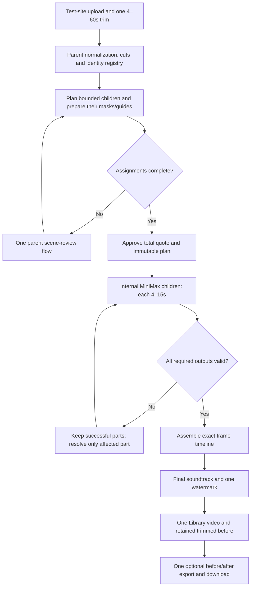

# One-minute renders: design and production-isolation plan

**Status:** design only; no implementation or deployment authorized by this document.  
**Requested by:** Frank, October 24, 2026.  
**Source baseline:** `d2a1ef5b`, reviewed on branch `1minute`.  
**Initial destination:** the connected test site, not the production website.

## 1. Intended experience

A user uploads a video, selects one continuous section of 4–60 whole seconds,
selects the people and reference images once, and receives one finished video.
The backend makes the necessary MiniMax requests of at most 15 seconds each.
The Library shows one render, one total credit charge/settlement, one retained
trimmed original, one finished recast, and one downloadable before/after video.

The existing 4–15-second production path must remain unchanged. The existing six
prompt choices remain six choices; long rendering is a separate capability, not
a seventh prompt family. Manual/Easy, masking, depth, mesh, audio, preparation
provider, reference cleanup, and recovery behavior must be explicitly accounted
for rather than silently replaced by one preferred combination.

This is technically feasible, but four independent model generations do not
promise the visual continuity of one native 60-second generation. A person,
wardrobe, camera treatment, cut timing, lip motion, or provider-generated voice
can change at a chunk boundary. Technical completion and creative acceptance
must be evaluated separately.

### Recommended starting architecture

- A durable **parent render** coordinates bounded **internal children**.
- Normalize the full trimmed section onto one 24 fps timeline.
- Keep SAM archives, guides and provider requests within their existing child
  bounds; do not feed a 1,440-frame video into helpers that accept 360 frames.
- Establish identity/scene assignments across the parent before any paid render.
- Approve one complete plan and quote, then generate children with durable,
  independently recoverable submission records.
- Assemble the video, apply its final soundtrack and watermark once, then make
  one comparison from the full trimmed original and the assembled result.
- Test through a dedicated backend, queues, operational state and rollout flag.

## 2. Production must stay isolated

### Important current fact

`firebase.preview.json` and `firebase.launch.json` both route `/api/**` to
`recastfx-api` in `us-east4`. Admin defaults live in the shared
`control/pipeline-settings.json`. A preview-only slider, or a new boolean in that
shared record, does **not** isolate backend behavior or processing resources.

### Proposed test deployment boundary

The names below are proposals; none of these resources are being created now.

| Concern | Test-only design | Production invariant |
| --- | --- | --- |
| Frontend | Build and deploy the long-render UI only to `recastfx-polished-preview` | Do not deploy the feature build to `recastfx-franky`/`recastfx.com` |
| API | Dedicated long-render service, e.g. `recastfx-long-test`; preview-only `/api/long-renders/**` rewrite | Existing production API image/routes continue accepting at most 15s |
| Identity | Verify the existing Firebase project's signed user identity and job ownership | Same identity does not grant arbitrary access to other users or child jobs |
| Rollout | Service-level enable gate, test Admin switch, and approved tester allowlist | No production-wide 60s setting; Origin alone is not authorization |
| Job state | Dedicated parent/child record namespace, preferably a separate test bucket | Existing `jobs/`, account indexes and production job scanners remain unchanged |
| Artifacts | Test-owned temporary/Library prefixes or bucket with explicit lifecycle | Do not alter production bucket lifecycle or delete production media |
| Queues | Separate long-render preparation, render/poll and assembly queues | Do not change production queue concurrency, retries or dispatch rates |
| Admin defaults | Test-specific settings record, initially copied from a named production settings revision | Test changes do not update the existing shared settings record |
| Wallet | Prefer an isolated, clearly labelled test-credit ledger for the first proof | No unintended production wallet debits, refunds, bonuses or index writes |
| Provider spend | Real provider calls remain paid; cap total test spend and attempts | A separate app service does not isolate a shared provider balance or rate limit |
| GPU/audio workers | Replicate plus isolated CPU composition first; worker route needs separate safe capacity | Do not acquire a separate coordinator that bypasses the production shared-worker lease |
| Cloudflare budget | Parent-wide request/time budget inside the existing account/Gateway cap | Four children must not each silently receive a new full matching budget |
| Observability | Every event carries test environment, parent, child and attempt identity | Production dashboards can separate test activity; no fabricated usage totals |

The preview can retain its normal short-render routes while only the long-render
routes go to the isolated service. Its long-render Library view must explicitly
merge its test-parent list if normal short renders are also shown. Internal
children must never appear as regular clips in either Library.

**Wallet choice is an implementation decision requiring agreement:** if the
intention is to test real consumer charges against the existing wallet, those
writes are intentional shared account changes, not complete data isolation.
They need explicit test account selection and reconciliation. Likewise, reusing
production provider keys consumes the same provider funds and limits even if
all application infrastructure is separate. A dedicated restricted test key or
provider subaccount is preferable where supported.

The existing `deploy_launch.py` deploys the production service, updates shared
infrastructure and preserves production bindings. Do **not** reuse it unmodified
as the long-render test deployment command. Create a separate target with
assertions on service, hosting site, bucket, queues and service account.

### Admin control and capabilities

Proposed label: **One-minute renders (test site)**. Default: **off**.

Effective enablement requires all of:

1. Dedicated backend environment permits long renders.
2. Test Admin setting is enabled and the account is allowed to test.
3. Selected route has passed its capability gates.
4. Provider credentials/budget and bounded execution capacity are available.

The backend returns capabilities such as `max_selected_seconds`, supported
routes and a settings revision. The frontend does not infer permission from a
hostname or hardcoded feature flag. Snapshot the effective policy on accepted
parents. Switching the flag off blocks new parents, but already accepted work
continues under its approved snapshot. Emergency cancellation is a separate,
audited operation; it cannot reverse accepted provider charges.

## 3. Verified limitations in the current implementation

These are source findings, not assertions about every capability a provider
might offer outside our adapter.

| Area | Current constraint / source | Required treatment |
| --- | --- | --- |
| Provider request | `provider.generation_payload`: `minimax-h3`, 768P, adaptive ratio, one video, 1–5 references, prompt ≤7,000 characters | Preserve the child contract; verify current provider limits before paid tests |
| Backend selection | `media.Setup.validate_range`: 4–15 whole seconds | New parent schema; keep bounded child schema |
| UI trim | `model/model.ts`, `trimRange.ts`, `TrimStep.tsx`, store, walkthrough and `livePipeline.ts` independently cap/validate 15s | One capability-driven live duration contract across all those paths |
| Recovery trim | `jobRecovery.ts`, store restore defaults use 15s | Restore full parent trim/manifest without clamping it |
| Upload | Source cap is 100 MiB in frontend/backend limits | Retain this cap initially and explain it; a minute of high-bitrate phone footage may exceed it |
| SAM/geometry | `tracking.py` and `mask_geometry.py` cap mask archives at 360 frames | Process bounded children; retain globally stable identity mapping |
| SAM input | `media.sam_input_video`: 24 fps and ≤360 frames | Split canonical parent media before this helper |
| Scene thumbnails | `media.scene_thumbnails` rejects frame IDs ≥360 and >300 requested thumbnails | Parent-aware bounded thumbnail path or translate through child windows |
| CPU compositor | `worker_patch/composite.py`: 1–360 sequential mask frames and matching guide/audio duration | Keep it a child processor until separately benchmarked/redesigned |
| Guide downloads | Enhanced guide 50 MiB; vocals-only guide 10 MiB | Asset-specific parent/child caps, not a blanket increase |
| Other transfers | Generic Cloud download defaults to 100 MiB; Replicate paths have their own output caps | Audit each larger parent artifact independently |
| Audio bytes | 60s stereo 44.1kHz 16-bit PCM is 10,584,000 bytes, greater than 10 MiB | Whole-minute guide-audio processing needs a specific cap/capacity change |
| Timing | Media subprocess default 90s, probe 20s, decoded-audio check 30s; comparison 120s | Explicit parent-stage deadlines and benchmarks |
| Infrastructure | Gateway: 2 CPU, 2 GiB, concurrency 4, 1,800s request timeout; individual worker invocation ≤600s | Independent resumable stages; constrain heavy finalization concurrency |
| Preparation | `Pipeline.prepare`: 1,200s overall deadline with worker lifecycle guards | Do not run all minute work inside one unchanged prepare invocation |
| Billing/status | One provider task, one generation debit/refund identity per job | Parent/child ledger and state model |
| Private-key recovery | Encrypted personal provider keys expire after two days | Re-entry if expired; never silently fall back to another billing source |

The existing model has a one-second internal/demo minimum while live generation
requires four seconds. Keep demo behavior separate and make the new live parent
and child rules consistent.

## 4. Exact timeline and chunk planning

### Three coordinate systems

- **Source time:** the position in the full uploaded file where the user clicked.
- **Parent-local frames/time:** the trimmed original, starting at frame zero.
- **Child-local frames/time:** position relative to that child's start frame.

Normalize the selected parent once to 24 fps, accounting for rotation, display
aspect/SAR, variable source frame rate and trim start. Keep the original RGB and
continuous trimmed soundtrack. A whole-second 60s parent has exactly 1,440 frames.
All intervals are half-open: `[start_frame, end_frame)`.

For a 60s parent:

| Child | Parent frames | Child duration | Parent seconds |
| --- | --- | ---: | --- |
| 1 | [0,360) | 15s | [0,15) |
| 2 | [360,720) | 15s | [15,30) |
| 3 | [720,1080) | 15s | [30,45) |
| 4 | [1080,1440) | 15s | [45,60) |

No boundary frame may be included twice or lost. Persist integer frame offsets;
do not recompute them later by accumulating floating-point durations.

### Avoid invalid short tails

For parent duration `D`, let `N = ceil(D/15)` and distribute whole seconds as
uniformly as possible across `N` children, adding one second to the first
`D % N` children. Under a 4–60s parent contract this produces valid 4–15s children.

| Parent | Proposed child lengths |
| ---: | --- |
| 4s | 4 |
| 15s | 15 |
| 16s | 8 + 8 |
| 29s | 15 + 14 |
| 30s | 15 + 15 |
| 31s | 11 + 10 + 10 |
| 45s | 15 + 15 + 15 |
| 46s | 12 + 12 + 11 + 11 |
| 59s | 15 + 15 + 15 + 14 |
| 60s | 15 + 15 + 15 + 15 |

Naive 15+15+15+1 splitting is invalid. The plan is immutable once approved and
priced; a changed plan invalidates affected guides, payload hashes and quote.

### Scene cuts are not chunk boundaries

Run scene detection over the canonical full trim and retain global shot IDs.
Do not silently change the detector threshold (currently 0.25). A shot can
intersect two or more children. Record both the global shot and its child-local
intersections so the person identity or verified absence is inherited on each
side of an artificial boundary. Do not inherit a stale click position or SAM ID.
Each independent child archive still needs a verified local frame/point derived
from continuous tracking, boundary matching, or an additional review pick.

A future cut-aware planner may improve seams, but actual cuts often fall at
fractional seconds. Exact cut-aligned windows conflict with the current
whole-second child-duration contract. Padding/overlap would change billed
seconds and require explicit discard ranges. **V1 should use deterministic
whole-second windows with no overlap or default crossfades.** Investigate
cut-aware/padded generation as a separately costed experiment later.

## 5. Parent state, internal children and idempotency

### Proposed parent manifest

Persist a versioned manifest before paid generation containing:

- Owner, environment, parent ID, creation time, schema/version and policy revision.
- Source object generation/checksum, source trim, canonical FPS/canvas/frame count.
- Processed reference objects and hashes; no pending browser cleanup operations.
- Parent identity registry: immutable person ID, reference slot, original selection,
  source crop, stable color/label slot, and explicit scene presence assignments.
- Global cuts/shots, chunk windows, local target maps and review revision.
- Requested and effective settings, prompt family, locator policy and fallback
  decisions; exact per-child guide/prompt/payload hashes.
- Approved quote, child allocations, settlement identities, spend/attempt ceilings.
- Per-child progress, submission intent, provider task, result generation/checksum,
  actual billing, retry state and deadlines.
- Parent assembly, soundtrack, watermark, Library, comparison and cleanup states.

Do not store raw provider keys, login tokens, entire reference payloads or signed
URLs in diagnostic logs or exportable manifests. Persist durable private URIs;
create signed URLs immediately before each child submission, with TTL compatible
with provider fetch timing. Do not pre-sign all four children at parent creation:
the current signer caps links at one hour, and queued later children can start
after those original links expire. Copy successful provider outputs promptly
rather than waiting for the last child to finish.

### Internal child model

A child is not a regular public account job. It must not independently call
normal account binding, charge a full generation, award a watermark bonus, archive
itself to Library, or clean up shared assets. Use immutable
`parent_id / child_id / attempt_id` identities plus provider request fingerprints.

Proposed states include `planned`, `preparing`, `needs_review`, `ready`,
`submitting`, `submission_unknown`, `generating`, `output_saving`, `succeeded`,
`failed`, `cancelled_unsubmitted`, and `passthrough`. Parent states aggregate these
into user-facing preparation, review, generation, recovery, assembly and completion.

Each state transition uses the existing generation-precondition/lease approach
rather than assuming an HTTP request happens only once. Use child-specific task
names and operation keys. A successful sibling is never resubmitted by a parent
poll, reload, export failure or queue retry.

Before a paid POST, persist a submission intent. If acceptance is ambiguous,
freeze that child's allocation in `submission_unknown`; reconcile its task ID
rather than posting again. Preserve the same fail-closed behavior in Replicate
prediction creation. `sam` and `depth` prediction keys must be scoped to child,
input fingerprint and recovery attempt, not reused across four different inputs.

## 6. Identity across children: the most important design issue

The current payload validator requires each target's time to be inside its
submitted clip. A selection at parent second 42 cannot be copied into child 1.
Subtracting 45 seconds or resetting every child's anchor to zero does not create
a valid identity assignment.

Before submitting each child, establish for each selected person:

1. A trustworthy child-local position/time and relevant scene assignments; or
2. Authoritative absence in that child; or
3. An unresolved state requiring review.

Uncertainty must not be treated as absence. If no selected person is present,
authoritatively mark a pass-through interval and retain the original video;
do not manufacture a target or pay to ask the model to replace nobody.
Pass-through content still participates in exact assembly, output audio policy,
parent watermark, duration and comparison.

### Stable person slots

`multi_tracking.style_targets()` currently derives label and color from the local
array index. Filtering persons 2 and 5 into a child would otherwise relabel them
as persons 1 and 2. The parent must own immutable identity/reference/color slots.

A child can use a validated local subset, but must persist an explicit
`parent person → child SAM IDs → child reference index → actual guide color`
map. Never use SAM track numbers as global identity across cuts or separate SAM
runs. Provider picture numbering may be compacted locally only if the matching
reference list and prompt mapping are rewritten together and recorded.

### Manual, Easy and locator policy

- **Manual:** use one parent review flow for source-person assignments. Clip the
  reviewed presence/absence intervals into every intersecting child. A global
  shot identity assignment does not make its original coordinate/SAM ID valid
  in another independently processed child. Obtain a trustworthy local point
  from verified tracking/boundary matching, or request an additional boundary
  review pick when necessary. Do not promise one click per 30s shot will seed
  several independent SAM archives automatically. Rebuild only affected child
  guides, except a changed global identity/reference mapping can invalidate more.
- **Easy, option 6:** extend matching to accept the parent's original source-person
  crops, rather than requiring the original anchor to fall inside every child's
  mask archive. Match source people, not replacement reference faces. Enforce
  one-to-one assignments and explicit absent/uncertain outcomes.
- **Easy, options 1–5:** today's local tracking does not solve identity in a later,
  independently processed child. Either add an explicitly enabled, separately
  costed parent locator, or guard the unsupported combination and offer Manual
  review. Do not quietly call it identical to the old route.
- **Replace everyone:** one reference can map to all local people; no per-person
  identity matching is needed. Still preserve scene/chunk boundaries, empty
  scenes and per-person motion; do not duplicate people or run unrelated matching.

**Recommendation:** make the locator layer separate from the prompt family in
long renders. Start Easy tests with option 6. Expand options 1–5 only after the
new locator policy is explicit in settings, quotes and recorded settings used.
Manual parent assignments can enable other prompt families without pretending
cross-chunk matching has already been solved.

### Single-shot and no-review behavior

A 60s single shot becomes four independent SAM runs. Zero detected cuts does not
prove the same person/ID survived across those artificial boundaries. The old
one-shot shortcut is valid only inside a verified continuous archive; do not
apply it to the entire parent without boundary continuity evidence.

Keep the existing jump detector diagnostic-only. Do not introduce automatic
jump-based rejection while adding long renders.

For option 6's no-review fallback to option 5, each relevant child must already
have trustworthy local anchors or authoritative absence. Shared cyan plus an
out-of-window parent anchor is not a valid fallback. If identity cannot be
established, pause for review or block that test route before paid submission,
even if the ordinary short-job no-review switch would continue. Make that long-
render exception visible rather than silently weakening identity requirements.

Matching budgets are parent-wide: current matching has a 120-request cap,
24-candidate cap and a bounded deadline. Do not automatically multiply all of
those allowances by four. Cache source crops and matching results by immutable
inputs/shot/identity, and record additional boundary matching calls and cost.

## 7. Every prompt family and processing route

### Prompt-family compatibility

All times and intervals below must be child-local at payload construction.
Each payload keeps the selected family and the same-camera sentence. Generate
prompts from the child's actual guide; do not find-and-replace timestamps in an
already-rendered full-minute prompt.

| Admin option | Long-render adaptation | Special guard |
| --- | --- | --- |
| 1 — Current prompts (`current`) | Existing family with child-local target and reviewed scene assignments | Original parent anchor alone is insufficient in later children |
| 2 — Favorite across modes (`favorite_v2`) | Retain favorite corrections and anchor/absence wording per child | Preserve reference/guide-specific branches, including coordinate fallback |
| 3 — Structured, same-camera (`structured_v1`) | Child-local subject definitions, retention instructions and detail text | Do not describe a 60s video or list out-of-window shots in a 15s payload |
| 4 — Structured identity colors (`identity_colors_v1`) | Reviewed/stable identity colors where the actual guide supports them | Easy without verified identity map remains shared cyan; depth can be shared tint |
| 5 — Easy tint tracking (`identity_tint_tracking_v1`) | Preserve Easy tint-at-anchor/fallback logic; Manual stays its existing branch | A generic tinted mask is not proof of cross-chunk identity |
| 6 — Cloudflare matching (`cloudflare_identity_v1`) | Use parent source crops/shot matches to assign child masks and stable slots | Budget shared across parent; unresolved identity needs safe review/fallback |

The request remains a bounded MiniMax child payload. Preserve reference limit,
requested resolution, actual mask style, mesh notes, silence/audio descriptions,
absence behavior, and prompt-length checks. Large parent scene schedules should
usually become smaller child schedules, but each child's full prompt must still
pass the existing 7,000-character cap before charging/submitting.

### Route matrix

| Effective route | Work per child / parent | Required long-render rule |
| --- | --- | --- |
| Enhanced on, depth off | SAM masks, then selected shared or identity overlay, CPU compose | Stable parent slots; preserve 20% overlay behavior and actual selected prompt family |
| Enhanced on, depth on | SAM + depth through chosen preparation provider; CPU depth/tint guide | Preserve saved opacity; translucent depth's shared magenta is not an individual identity color |
| Enhanced off, mesh off, options 1–5 | Original guide and coordinates; ordinarily no SAM | A parent locator may add new analysis only if explicitly enabled; otherwise require valid Manual child anchors |
| Enhanced off, mesh on | Original-visible guide plus mesh; SAM can still be required internally | Never equate "no overlay" with "no segmentation" |
| Enhanced off, option 6 Easy | SAM can run internally for identity matching, without visible masks | Keep internal analysis distinct from the submitted visual guide |
| Manual with tracking | One parent scene review backed by bounded child masks/thumbnails | Rebase assignments, persist revision, and retain review previews |
| Manual without tracking | Original-RGB coordinate scene review | Still needs locally valid positions for every applicable child |
| Easy success, no review needed | Automatic preparation/matching and generate after parent approval | Do not build unused tracking preview videos for every successful child |
| Easy needs attention | Parent review links to affected shots/parts | Preserve completed preparation; do not restart all children |
| Replace everyone | One reference, local people/union masks as appropriate | Skip identity matching; handle no-person sections without hallucinated replacements |
| Multi-characters off | One chosen person + one reference | Enforce on parent intake, resume and retry; current control also disallows replace-everyone |
| Multi-characters on | Up to existing five-person/reference limit | Do not increase references or selections because duration increased |
| Replicate preparation | Child-specific pinned SAM/depth predictions and validated downloads | Separate operation keys, no worker-GPU duplicate route, parent aggregate spending |
| Self-hosted preparation | Bounded SAM/depth calls, lifecycle and shutdown guards | Separate capacity for strict production isolation; do not bypass production slot coordination |
| Retry missing masks enabled | Retry only the missing selection/affected child using snapshotted policy | Cache successful masks/depth; record repair costs and no paid-provider regeneration |
| Recovery falls back to coordinates | Actual child-local saved/reviewed coordinates | Never borrow another child's coordinates or call uncertainty a valid selection |

New jobs currently snapshot depth opacity at 0.2 and guide style version 2.
Identity-depth colors require a different full-strength multi-person path;
the normal translucent depth path uses a shared tint. A long-render implementation
must use `guide_style()` and `compose_styles()` consistently, not assume that
option 4/6 always produces distinct visible depth colors.

### Mesh/admin visibility and reference preparation

Snapshot global mesh enable, user-control visibility, masked default, unmasked
default, permitted explicit override and the final effective mesh boolean.
Hiding a control does not disable processing. Global mesh-off must remain an
enforced override. Treat the hidden audio control the same way: visibility is
not an audio processing mode.

Use the same fully prepared reference objects for every child. Wait for cleanup
completion, preserve the user's original-versus-clean choice, use white-backed
clean references where that route calls for them, and hash the final submitted
objects. Do not repeat reference cleanup four times or allow a reference to
change halfway through a parent. Keep preparation-provider exclusivity on initial,
retry, depth and mask-recovery paths.

## 8. Audio: preserve the actual mode semantics

Current guide pitch processing and final audio restoration are different decisions:

| Audio processing | Submit without audio | Submitted guide | Final soundtrack policy today |
| --- | --- | --- | --- |
| On | Off | Isolated vocals shifted +3 semitones | Restore the original selected soundtrack |
| Off | Off | Source audio stays in the guide | Keep provider-returned audio |
| On | On | Silent input; pitch work skipped | Restore original selected soundtrack |
| Off | On | Silent input | Restore original selected soundtrack |

Do not change the second row to original audio just because it is easier to
stitch. That would change the user's selected behavior.

### Parent audio pipeline

1. Retain one exact continuous original soundtrack for the full parent trim.
2. For pitch processing, prefer one bounded full-parent Demucs/vocals + rubberband
   pass, then sample-exactly slice the guide vocals into children. Current pitch
   ratio is approximately 1.189207115, tempo unchanged. Benchmark whole-minute
   worker runtime and raise only the specifically justified WAV transfer bound.
3. If full-parent audio processing is not proven, use separately approved analysis
   windows with context and exact delivery spans; do not imply four independent
   stems automatically have seamless boundaries.
4. With silent input, cache the silent guide against the exact child guide
   fingerprint. A reviewed rebuild must invalidate the old silent copy.
5. When restoring original audio, assemble video first and mux the one continuous
   original parent soundtrack once. Apply the source trim offset once, not again
   for each already-trimmed child.
6. When preserving provider audio, decode each child's result to a canonical PCM
   sample format, validate exact span, concatenate PCM and encode AAC once.
   Generated voice/music changes are a creative risk even with sample-exact muxing.
   For an authoritative pass-through child, use the original parent source audio
   for exactly that span: no provider audio exists there. Test generated-to-source
   and source-to-generated joins explicitly.
7. No automatic crossfades, speed changes, new dialogue or arbitrary invented
   silence to hide missing audio. Preserve only specifically validated existing
   repairs, such as the current sub-100ms pitch-filter tail padding; do not extend
   that allowance to a materially short/missing child soundtrack. Other short
   audio follows an explicit failure/recovery policy.

Keep sample-count validation as well as container durations. At 44.1 kHz, a
60-second final soundtrack covers 2,646,000 sample frames per channel. Watch
encoder priming, delayed audio streams, timestamp offsets, EOF rounding, and
speech crossing a child boundary.

## 9. Assembly, watermark, comparison and delivery

### Video assembly

Adaptive child outputs can have different dimensions; the current short exporter
intentionally accepts differing provider/source canvases. Do not revive the old
rejection of every dimension mismatch, and do not assume stream-copy concat works.

Proposed v1 policy:

- Persist one deterministic parent output policy; resolve the canonical canvas
  from the lowest timeline-index required generated child once it is valid,
  not whichever child finishes first. Fall back to the parent normalized canvas
  if every interval is pass-through. Freeze the resolved dimensions across retries.
- Conform all child videos to the same canvas/FPS/pixel format/SAR, using padding
  to preserve aspect ratio rather than stretching/cropping by default. Snapshot
  color primaries/transfer/matrix/range as well as pixel format. Mixed HDR/SDR
  output needs an explicit tested conversion policy; gate unsupported HDR inputs
  rather than silently treating a pixel-format conversion as correct tone mapping.
- Validate each child matches the planned frame count, duration and timestamps;
  trim surplus generated frames, but reject materially short results rather than
  stretching motion or repeating several missing frames. These checks cannot
  prove the model preserved source action/cut timing; inspect that separately.
- Assemble ordered video-only ranges with exactly the parent frame count.
- Choose an implementation that avoids decoding all four full clips into memory
  simultaneously and minimizes redundant lossy encodes. Measure stream-copy only
  where codec parameters, dimensions and timestamps are actually compatible.
- Apply the parent soundtrack and final watermark during the final encode/mux.
- Validate the full output by decoding it, checking frame count, duration, canvas,
  sound coverage and boundary positions before declaring main delivery complete.

If future continuity tests need overlap, freeze explicit generation and delivery
windows and account for additional input/output seconds. Do not silently add paid
handles or discard/duplicate action in v1.

### Watermark and credit bonus

Apply the existing selected watermark once to the assembled parent video, using
its final dimensions and the existing inset white/coral `recastfx.com` treatment.
Children are intermediate and should not be independently watermarked. Award the
watermark bonus once per parent after successful main delivery, using one durable
idempotency identity. A child retry must not award it again. Preserve eligibility
checks for paid work; an all-pass-through/zero-generation parent must not become
a way to farm watermark credits.

### Before/after export

Create one comparison from the **full trimmed parent original** and the **final
assembled/watermarked parent recast**:

- Portrait original: before left, after right.
- Landscape or square original: before above, after below.
- One audible soundtrack, from the finished recast; never play two soundtracks.
- Keep the existing panel-size/quality policy explicit; no four independently
  watermarked comparison exports concatenated together.
- Show the one resulting file in Library's Before & after tab with its own
  **Download before & after** button and filename.

The production-code 15s comparison check took 35 seconds. A linear 60s estimate
would be 140 seconds, already beyond today's 120-second comparison timeout, but
runtime need not scale linearly. **Benchmark it; do not promise the old deadline
will work.** Use a bounded, separately resumable parent comparison stage so the
successful main video can become available while comparison is processing.
Comparison failure must not fail the main video, refund/regenerate successful
children, or charge again. The UI needs processing/failed/retry states for the
comparison instead of an indefinitely unexplained disabled download button.

### Retention and cleanup

One parent Library record owns the main video, trimmed before, poster, small
reference thumbnails and comparison. Private main/before/comparison retention
remains 30 days, with short-lived signed access links. Old 15s clips are not
backfilled by this feature.

Retain child outputs and shared dependencies while the parent is recoverable.
Do not call the normal child's Library delivery or cleanup as each part finishes.
That would create extra clips/bonuses and could delete assets needed by siblings.

Verify durable object generation/checksum and parent archive before cleanup.
An optional pending comparison must retain exactly the before/final assets it
needs. Assembly failures retain successful children for a bounded recovery window.
Define an explicit abandoned-job cleanup policy; a two-day storage lifecycle is
not a replacement for active job dependency tracking. Personal-key expiry can
require re-entry without discarding successful media.

## 10. Quote, credits, provider costs and refunds

### Keep the existing unit

The pricing catalog's generation rate is **per 15 seconds**. Keep that rate
denominator. The current helper explicitly rejects durations above 15, so add a
parent quote/allocation layer. Separately, `reference_seconds` is a margin-
calibration assumption, not the pricing unit. A long-render calibration must
model parent overhead plus per-child overhead; it may include a 60-second
scenario without redefining what a per-15-second credit rate means.

Recommended quote: sum immutable per-child rounded credit allocations, using the
saved catalog revision and only the children that need generation. The quote
must explicitly state the number of model requests and any approved extra billed
seconds. Do not imply 60s always costs exactly 4× every other expense: rounding,
minimum billable duration, extra reference-input costs, preparation, matching,
retries and provider billing rules all need separate verification/accounting.

Preparation can also incur real Replicate/Cloudflare/worker costs before that
final quote exists. Require an initial bounded preparation/matching budget before
starting those operations, then approve the exact generation allocation after the
identity/guide plan is known. A final render quote must not be mistaken for prior
authorization of unlimited analysis or repair calls.

Plan and validate all child payloads before the first paid generation submission. A changed
review, boundary, target map or price requires an updated quote/approval. Check
wallet affordability for the complete approved plan, not just child 1.

### Proposed settlement behavior

1. One parent charge/reservation, with immutable child allocations summing to the
   approved total; no independent four-full-render wallet debits.
2. Persist a child submission intent before its paid request. Record accepted
   provider task identity and eventual actual cost on that child.
3. A rejected/not-submitted child can release/refund its unused allocation via
   its own idempotent settlement key. Do not reuse the existing one-job refund
   key with a different amount; the wallet rightly rejects conflicting amounts.
4. Successful paid children remain saved and paid for if another child fails.
   Show the parent as recoverable rather than pretending a whole finished minute
   exists. Do not silently full-refund successful provider work without an agreed
   business policy.
5. Unknown submissions keep their allocation unsettled until reconciled. Do not
   retry or assume zero spend simply because no task ID reached us.
6. A new paid regeneration attempt requires a new visible quote/approval unless
   a separately approved attempt budget already covers it. Preparation retry,
   polling, saving, assembly and comparison retries are not paid regeneration.
7. Show total credits used and returned once on the parent; optionally expand
   per-part allocations/actual usage. Do not expose four child cards as four bills.

**Refund policy is a product decision before implementation.** The table above
is a recommended partial-settlement approach, not an existing promise to users.
Explicitly decide whether users can download successful parts after an incomplete
parent and how expiry/retention applies to those recoverable assets.

### Finance and provider accounts

Preserve each child's provider task as the expense identity with parent/child
links. Never count both those child expenses and the summed parent usage as
separate expenses. Keep provider top-up payments distinct from render usage;
provider cash payments are not made four times by splitting a video.

Keep the credit-funded and permitted personal-provider-key paths separate.
Snapshot the access mode; no silent fallback from an expired personal key to
site funds. Shared provider balances/rate limits can still affect production:
use a bounded test budget, preferably dedicated keys/subaccounts, and report real
provider usage versus estimates explicitly.

## 11. Queueing, resource use, cancellation and recovery

Start the proof with serial child preparation and serial provider submissions.
Measure it before enabling concurrency. Four children do not justify four GPUs,
four copies of every Cloud Run service or changes to production max instances.
Later allow a small test-only concurrency cap after rate/cost/capacity checks.

Polling must be child-specific and independent of browser lifetime. The current
polling loop permits 120 checks at a 30-second cadence; a sequential minute can
outlive one child's polling window. Parent timeout is a separate budget and may
need multiple queued tasks, not one HTTP request holding all four generations.
Do not arbitrarily extend a global production deadline to make one minute work.

Use dedicated CPU finalization concurrency, initially one heavy assembly per
instance. The current 2 GiB / concurrency-4 gateway can be memory-bound if several
minute-long decoders/encoders run together. Benchmark peak RAM, scratch space,
network bytes and cost; retain zero minimum instances where appropriate. Any
self-hosted worker test must preserve bounded runtime/shutdown guards and have
separate capacity or an agreed idle-window plan. Sharing the live worker lease
is safer than bypassing it, but can still delay production and therefore does
not satisfy strict noninterference.

| Event | Required result |
| --- | --- |
| Browser closes/reloads | Parent resumes from durable state; no duplicate submissions or charge |
| One child prep fails | Retry only affected prep with limits; keep siblings and reviewed choices |
| One child provider POST is ambiguous | `submission_unknown`; reconcile before any new POST |
| One child definitively fails | Parent needs attention; preserve successful children and settle according to policy |
| Child completes out of order | Save by child ID; assemble by immutable frame order |
| Main assembly fails | Retry from saved child outputs; no new model calls |
| Main upload succeeds but state write fails | Verify/reuse saved object with generation/checksum; idempotent recovery |
| Comparison fails | Main remains complete; optional comparison retry only |
| Admin defaults change | Existing parent/children keep their frozen effective settings |
| User edits review/reference mapping | Invalidate affected preparations/payloads; never silently overwrite already-paid outputs |
| User cancels | Stop unsubmitted work and future tasks; attempt provider cancellation only where supported; settle accepted work truthfully |
| Key expires during review | Ask for the same permitted key source again; do not restart paid siblings |
| Parent abandoned | Release leases and unused reservation; bounded private retention/cleanup by dependency |

## 12. Frontend and API work inventory

The endpoint names in this section are proposed, not existing routes.

- Add test-only capability/settings and long-render quote/intake APIs under
  `/api/long-renders/`; don't weaken the existing short-render Setup endpoint.
- Parent operations: create/upload registration, prepare/status, review/save,
  approve/generate, cancel, resolve unknown submission, retry a specific part,
  retry assembly and retry comparison. Children are server-owned resources.
- Carry the parent schema, capabilities and review revision through
  `livePipeline.ts`, `useLivePipeline.ts`, walkthrough/store and retry drafts.
- Audit `TrimStep`, `trimRange`, model constants, store initial/reset/restore,
  selected-duration display, button validation, upload manifest, quote,
  submission/recovery and exact-end-of-file rounding. A single slider change is
  not sufficient. Preserve full-upload selection times until parent normalization.
- Wait for all reference cleanup operations before freezing input objects.
- Manual review is one parent view grouped by global shots, not four separate
  user setups. Internally resolve which child preview/mask backs each section,
  and surface any extra boundary pick needed for an independent SAM archive.
  Load only needed preview windows/thumbnails on mobile; do not decode all 1,440
  full-resolution frames or download four full mask archives into iPhone memory.
- Progress: preparing, needs review, generating part 2 of 4, waiting/failed parts,
  assembling, main ready, comparison processing/ready. Do not show paid work as
  still uploading or require the tab to remain open after safe registration.
- One Library card and details panel: total duration, aggregate credits/refunds,
  effective settings and optional per-part timing/cost diagnostics. Create stays
  available while background work continues.
- Main download and comparison download are independent. A parent can be main-
  complete while optional comparison remains pending. Old short jobs retain
  their existing display/recovery behavior.
- Add safe parent/part summary fields to `libraryExport.ts` where appropriate,
  excluding credentials and signed private URLs.

## 13. Logging and measurable acceptance

Record parent/environment/child/attempt IDs and immutable input/plan hashes on
all stage events, without leaking keys or signed URLs. Required measurements:

- Parent source/trim length, canonical frame count, child windows and planner version.
- Effective settings revision, requested/effective prompt and locator/fallback policy.
- Upload/download bytes, queue wait, startup, normalization, cut detection,
  reference prep, SAM/depth, recovery, matching calls, composition and guide audio.
- Original/child-local identity anchors, remapped slots, authoritative absence,
  unresolved assignments and review changes. Keep jump flags diagnostic-only.
- Paid submission intent/outcome, provider task, polling, saved-output verification,
  actual/estimated provider cost and wallet settlement identities.
- Assembly/media conformance, soundtrack choice, final frames/samples, watermark,
  poster/before retention, comparison, upload and cleanup.
- Parent wall time excluding user review, per-part latency, peak resources and
  test budget consumption. Distinguish saved output from creative approval.

### Automated tests, before any paid minute

1. Duration 4,15,16,29,30,31,44,45,46,59,60; reject invalid >60 and invalid short
   children. Nonzero/fractional trim start and exact source EOF.
2. Prove each parent frame appears exactly once; children stay ≤360 frames,
   every provider anchor is local/in range, and offsets round-trip correctly.
3. Person appears only in part 3; disappears/reappears; two similar people;
   only an arm/back visible; nobody selected present; background-only shot.
4. Stable person/color/reference slots with missing people and local reference
   subsets. No duplicate identity assignment to one candidate.
5. True scene cut and artificial boundary immediately before/at/after each other;
   long continuous motion across all boundaries; one-shot shortcut guards.
6. All six prompt families: local subject/scene timing, actual shared/identity
   guide style, mask-free fallback, mesh and audio wording, same-camera sentence,
   7,000-character limit. Test absence rather than inventing anchors.
7. Route axes: Easy/Manual × enhanced × depth × mesh × provider × one/multiple/
   replace-everyone × audio policy × missing-mask retry × matching-no-review.
   Generate expected outcomes for all legal combinations cheaply; use pairwise
   coverage plus explicit high-risk cases for expensive integration tests.
8. Mesh globally disabled/hidden/default overrides; audio visibility vs behavior;
   multi-character control on intake, restore, review and retry.
9. Processed reference still pending, interrupted cleanup, white/original choice,
   reference edit after preparation, and source/reference expiration.
10. Original-restored and provider-audio paths; dialogue/music/silence across joins;
    delayed streams, AAC priming, short audio, generated/pass-through audio joins,
    rotated/VFR/SAR/HDR inputs.
11. Different child dimensions/codecs/frame counts; actual short result;
    out-of-order completion and exact common-canvas assembly.
12. Duplicate queue delivery, crashed submission, unknown acceptance, child failure,
    changed review/quote, cancellation, explicit retry and expired personal key.
13. Main save succeeds/comparison fails; assembly-only and comparison-only retry;
    no second generation charge or watermark bonus.
14. Live and archived Library signing/expiry, one parent item, recovery and cleanup
    preserving siblings/shared inputs, no child leakage across accounts.
15. Production regressions: normal API still rejects >15; ordinary Admin defaults,
    wallet/indexes, provider routing, mask retry and 15s exports remain unchanged.
16. Production-isolation assertions: preview deployment cannot target production
    service/site/queues/bucket; changing the test flag changes no production record.

### Bounded creative/runtime tests after the design is approved

- First use saved/synthetic outputs to test 60s assembly/audio/watermark/comparison
  without paying for new generations. Measure full-minute normalization and guide
  audio separately; compare both orientation exports on actual CPU resources.
- Then one real 60s test with default option 6, Easy, enhanced, depth off, existing
  chosen mesh/audio policy, Replicate preparation, and a verified global identity
  plan. Set spend and runtime ceilings before starting; no automatic paid retry.
- Add a Manual test, a long single shot, multi-cut/absent-person cases, then the
  alternate audio and depth/provider routes. Do not infer parity from one favorite.
- Inspect normal-speed playback and audio around every boundary, in addition to
  frame/sample validation. Review on desktop and a physical iPhone, including
  exact 60s trim, needs-attention recovery, actual Blob downloads and before/after.
- Expand prompt/route coverage incrementally under an approved batch budget.

## 14. Phased implementation and decisions to settle

| Phase | Deliverable | Exit condition |
| --- | --- | --- |
| 0 — Design review (now) | This source-grounded plan and open decisions | Agreement on isolation, identity locator, refund/audio policy and test budget |
| 1 — Offline contracts | Parent/child schemas, frame planner, route/prompt matrix, wallet settlement design | Local tests pass; production code/config untouched |
| 2 — Isolated assembly proof | Synthetic/saved children → one 60s main + comparison | Exact frames/audio, bounded resources, downloadable files; no provider generation |
| 3 — Isolated preparation/review | Replicate children, parent identity/scene review, references and guide audio | All intended child-local mappings valid, failure paths safe and measurable |
| 4 — One bounded provider proof | Approved parent → children → one Library item | Cost/time reconciled, no duplicate charge, boundaries reviewed |
| 5 — Route expansion | Remaining prompt families/audio/depth/worker combinations | Explicit capability matrix passed, unsupported routes remain gated |
| 6 — Separate production proposal | Tested migration/rollback and consumer policy | New approval required; test success alone is not permission to deploy live |

Recommended choices for the first implementation:

- Isolated service, queues, storage/settings and approved test accounts; no live
  duration/global-settings changes. Prefer isolated test credits initially.
- Parent cap 60s, minimum 4s, whole-second duration, existing source upload cap;
  balanced integer children with no overlap.
- Default first Easy proof uses option 6 plus a verified parent identity map;
  Manual supplies mappings elsewhere. Do not enable every unsupported combination
  just because a top-level long-render toggle exists.
- Serial preparation/submission first, parent-wide matching/spend limits,
  Replicate route first. Worker route gated on separate safe capacity.
- Preserve all current audio semantics; original-restored paths get one final
  continuous soundtrack, provider-audio path requires its own seam acceptance.
- One parent quote/settlement, saved successful children and explicit paid retry.
  Agree the partial-failure refund/download policy before coding billing.
- One watermark/bonus and one before/after export per parent. Main delivery can
  succeed before the separately recoverable comparison stage.
- No change to production until a later, explicit reviewed release decision.

## 15. Source map for implementation

Paths below refer to the baseline commit above; line numbers will move during
implementation. This is the checklist of current seams, not a list of files
that can all be changed by replacing `15` with `60`.

| Source | Relevant responsibilities |
| --- | --- |
| `firebase.launch.json`, `firebase.preview.json` | Current shared backend rewrites; separate hosting targets |
| `deployment/swapmein/deploy.py`, `deploy_launch.py` | Production target, scaler settings, worker identities, queues, bucket CORS/lifecycle, build/deploy safeguards |
| `swapmein/media.py` | Setup, normalization, scene cuts/thumbnails, SAM input, guide validation, audio samples, watermark and finish |
| `swapmein/pipeline.py` | Prepare/review/rebuild/finalize; normalization, all routes, optional comparison, before/poster/archive/cleanup |
| `swapmein/provider.py`, `prompt_variants.py` | Per-child contract, all six prompt builders, reference/time validation, 7,000-character cap, submission ambiguity |
| `swapmein/pipeline_settings.py`, `guide_style.py`, `job_settings.py` | Admin snapshot, character/mesh enforcement, effective guide styles and recorded settings |
| `swapmein/tracking.py`, `multi_tracking.py`, `mask_geometry.py`, `scene_selection.py`, `tracking_preview.py` | 360-frame limits, local labels/colors, masked/unmasked review and previews |
| `swapmein/cloudflare_matching.py`, `cloudflare_recovery.py`, `cloudflare_budget.py` | Source matching, shot candidates, absent alternative, request/deadline/budget bounds |
| `swapmein/replicate_preparation.py`, `replicate_recovery.py`, `initial_mask_recovery.py`, `mask_recovery.py` | Pinned prediction routes, durable paid-operation identity, bounded recovery |
| `worker_patch/app.py`, `composite.py`, `face_mesh.py` | Demucs/pitch audio, mask/depth/tint composition, mesh state and frame limits |
| `swapmein/app.py`, `cloud.py`, `storage.py`, `job_key.py` | Intake/session/upload/status/review/submit/poll, task routing, ownership, leases, signed URLs, key TTL |
| `swapmein/commerce.py`, `finance.py`, `accounts.py`, `watermark.py` | Quote/debit/refund, provider task expense identity, consumer credits/Library archive, bonus idempotency |
| `swapmein/comparison.py`, `cleanup.py` | Layout/encoding/timeout validation, verified delivery and shared scratch dependencies |
| `frontend/.../model/model.ts`, `useCharSwapStore.ts`, `utils/trimRange.ts`, `components/TrimStep.tsx`, `CharSwapWalkthrough.tsx` | Duration caps, time coordinates, restore/reset and walkthrough navigation |
| `frontend/.../services/livePipeline.ts`, `hooks/useLivePipeline.ts`, `services/jobRecovery.ts` | Live setup/review validation, job lifecycle and recovery draft |
| `frontend/.../services/commerce.ts`, `components/AdminPage.tsx` | Admin/capability typing, six prompt choices and every experimental control |
| `frontend/.../components/LiveTrackingStep.tsx`, `SceneTrackingReview.tsx` | Parent review presentation and assignment edits |
| `frontend/.../components/PreparationProgress.tsx`, `GenerationPage.tsx`, `AccountLibrary.tsx`, `GenerationDetails.tsx`, `JobSettings.tsx`, `utils/libraryExport.ts` | Parent progress, one card, aggregate credits, downloads, comparison state and safe exports |

Backend source paths abbreviated as `swapmein/` above are under
`deployment/swapmein/swapmein/`; worker paths under `deployment/swapmein/`;
frontend paths abbreviated with `...` are under `frontend/src/features/charSwap/`.

**Work performed for this document:** read-only source audits plus writing this
file on `1minute`. No application code, Admin settings, cloud resources, provider
calls, wallets, production deployments or preview deployments were changed.
